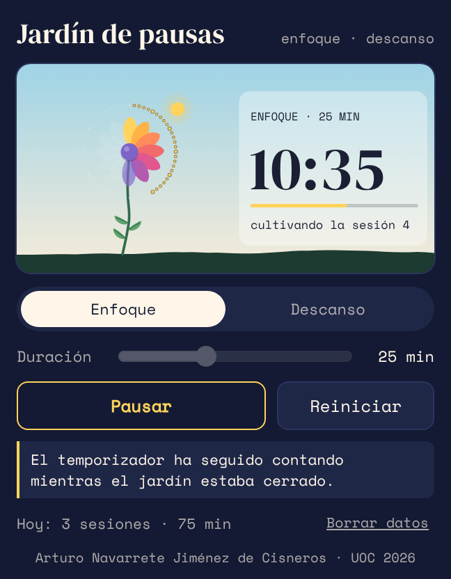
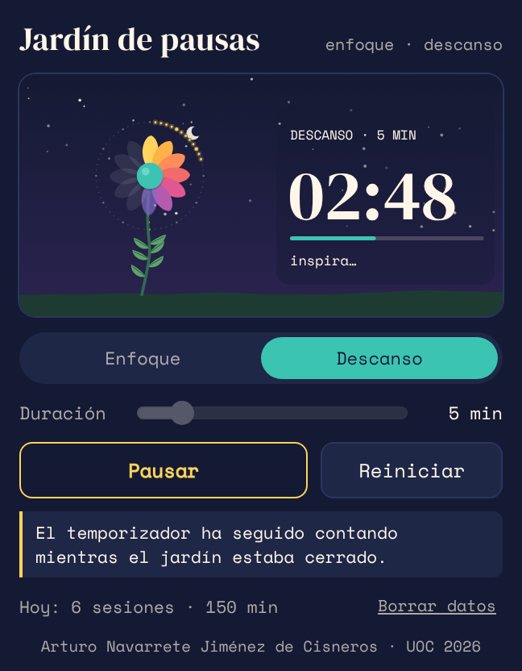

# Jardín de pausas 🌼

Extensión de **Firefox** (Manifest V3) para alternar sesiones de **enfoque** y **descanso**.
Mientras te concentras, una flor gana pétalos; cuando descansas, los suelta y su centro
«respira» contigo. Cada sesión de enfoque terminada hace brotar una hoja en el tallo.

Es la continuación de mi reloj creativo **«Jardín de horas»** (reto R1), adaptado a un
popup de 300 × 150 px con [p5.js 2.4](https://p5js.org/).

| Enfoque (mañana) | Descanso (noche) |
|---|---|
|  |  |

> Proyecto de la asignatura *20.671 Desarrollo de aplicaciones interactivas* (Grado de
> Multimedia, UOC) · Reto R3 «Extensión web» · noviembre de 2026.

---

## Funcionalidades

- **Dos modos:** Enfoque (5–60 min) y Descanso (1–30 min), con slider de duración.
- **Iniciar / Pausar / Continuar / Reiniciar**, también con la barra espaciadora.
- **La flor como reloj abstracto:**
  - pétalos → progreso de la sesión (12 doceavos);
  - anillo de polen → segundos del minuto en curso (se dispersa al completar cada minuto);
  - hojas → sesiones de enfoque terminadas hoy;
  - cielo, sol y luna → hora real del día.
- **Respiración guiada** durante el descanso: el centro de la flor crece 4 s y baja 4 s.
- **El tiempo sigue contando con el popup cerrado.** Al volver a abrirlo la animación
  continúa donde toca y, si la sesión terminó mientras tanto, se cuenta y se avisa.
- **Resumen del día** (sesiones y minutos) que se reinicia cada día a las 0 h.
- **Borrar datos** con doble confirmación.

## Instalación (modo desarrollo)

1. Descarga o clona este repositorio.
2. En Firefox, abre `about:debugging#/runtime/this-firefox`.
3. Pulsa **«Cargar complemento temporal…»** y elige el archivo `manifest.json`.
4. Aparecerá el icono de la flor en la barra de herramientas (si no, búscalo en el menú
   de extensiones 🧩 y fíjalo).

Requiere Firefox 142 o posterior.

## Cómo se guarda el estado

El popup de una extensión se destruye cada vez que se cierra, así que el temporizador no
puede vivir en variables. Guardo con `storeItem()` / `getItem()` de p5.js (que usan
`window.localStorage`):

| Clave | Contenido |
|---|---|
| `jp_estado` | `{ modo, minutos: { enfoque, descanso }, corriendo, inicio, transcurrido }` |
| `jp_dia` | `{ fecha, sesiones, minutos }` |

La clave está en guardar **cuándo empezó** la sesión (`inicio = Date.now()`) y no cuántos
segundos lleva. Al abrir: `transcurrido = Date.now() - inicio`.

Además, como Firefox borra el `localStorage` de las extensiones cuando el usuario limpia
el historial ([MDN](https://developer.mozilla.org/en-US/docs/Mozilla/Add-ons/WebExtensions/API/storage)),
hago una copia en `browser.storage.local`. Esa copia es la que necesita el permiso
`"storage"` del manifest; `storeItem()` por sí solo no lo necesita.

## Estructura

```
jardin-de-pausas/
├── manifest.json        Manifest V3 (popup, permiso storage, CSP)
├── popup.html           página del popup
├── style.css            estilos de la interfaz
├── sketch.js            setup(), draw() e interfaz DOM con p5.js
├── jardin.js            dibujo: cielo, flor, polen, partículas
├── estado.js            guardar / recuperar con storeItem() y getItem()
├── libs/p5.min.js       p5.js 2.4.0 local (MV3 no permite código remoto)
├── assets/fonts/        DM Serif Display y Space Mono (OFL)
├── icons/               iconos de la extensión
├── pruebas/             script de pruebas con Playwright
└── docs/                capturas
```

## Pruebas

`pruebas/probar_estados.py` abre el popup en un navegador sin ventana, fija la hora y
carga distintos estados en `localStorage` (sesión en marcha, terminada con el popup
cerrado, en pausa de un día anterior…) para comprobar que se recuperan bien.

```bash
pip install playwright
python -m playwright install chromium
python pruebas/probar_estados.py
```

El manifest se ha validado con `web-ext lint` (0 errores; los avisos son de `p5.min.js`).

## Tecnologías y créditos

- [p5.js 2.4.0](https://p5js.org/) — LGPL 2.1 (`libs/p5-LICENSE.txt`)
- [DM Serif Display](https://fonts.google.com/specimen/DM+Serif+Display) y
  [Space Mono](https://fonts.google.com/specimen/Space+Mono) — SIL Open Font License 1.1
- Sistema de partículas basado en *The Nature of Code*, cap. 4, de Daniel Shiffman.
- Inspiración original: los relojes de John Maeda (*12 o'clocks*).

## Licencia

Código bajo licencia [MIT](LICENSE) © 2026 Arturo Navarrete Jiménez de Cisneros.
Las librerías y fuentes incluidas mantienen sus propias licencias.
